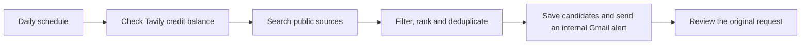

# Finding leads with n8n

I use a self-hosted n8n workflow at HEJ STUDIO to find public requests worth reviewing. It looks for Danish businesses seeking freelance help and for families or organisations looking for creative mentorship.

## How it works

- **One shared search budget.** The workflow checks the remaining Tavily credits and spreads them across the rest of the month. Roughly one in five scheduled queries looks for mentorship.
- **Separate filters for each type of work.** Freelance results need an explicit request for relevant help. Mentorship results need a recent public request from a parent or guardian, or an open call from an organisation. The workflow checks for duplicates and saves at most one candidate per category per run.
- **Human review.** The alert links to the original request. I verify the scope, timing and contact channel before deciding whether to respond.

## Example

Imagine a Danish shop publishes a request for help fixing its Shopify product pages. If the request passes the filters, n8n saves the link and sends me an email. I can then check what the shop needs and decide whether the project fits.

## What I verified

Live Tavily searches ran successfully, and an internal test confirmed Gmail delivery. The next measure is how many alerts lead to a relevant conversation.

[HEJ STUDIO](https://www.hejstudio.dk/)
